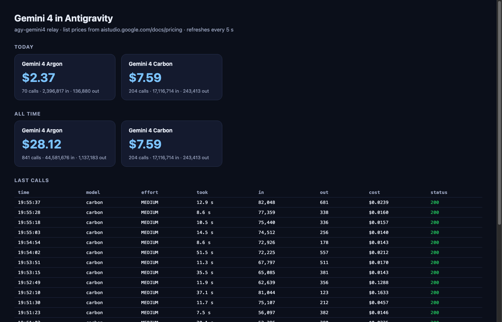

# agy-gemini4

**Gemini 4 Carbon, Gemini 4 Argon and the other Gemini models on your key, in Google Antigravity, with your own
Gemini API key.** Works in the `agy` CLI and the Antigravity desktop app, with a live dashboard of what every call costs.



## The short version (terminal only, nothing to install)

**agy 1.5.8 and later:** Carbon is built in for API keys. Measured on agy 1.5.9, 14 November 2026, with no relay and
no extra settings: `GEMINI_API_KEY=... agy --model gemini-4-carbon --effort high` answers at low, medium and high
effort (xhigh is not offered for Carbon). Update with the CLI's own updater and you may not need anything here; the
installer is still useful for the cost dashboard, the key in the Keychain and the desktop app.

**agy 1.5.5 to 1.5.7:** measured on `agy` 1.5.5, 11 November 2026, with `"modelProvider": "gemini"` in `~/.gemini/antigravity-cli/settings.json`
(Google's documented API-key mode):

- **Gemini 4 Argon** already works on an API key: `agy --model gemini-4-argon`.
- **Gemini 4 Carbon** is refused ("not recognized as a known model") until agy is told about it. Two settings are enough:

```sh
export GEMINI_API_KEY=...                                              # aistudio.google.com/apikey
export AGY_LLM_GATEWAY_URL=https://generativelanguage.googleapis.com
export AGY_LLM_GATEWAY_MODELS=gemini-4-carbon
agy --model gemini-4-carbon --effort high
```

That is all the CLI needs. The installer below is for people who also want the desktop app, the cost dashboard, the
key out of their shell files, and every model in the menu.

## The installer (CLI + desktop app + dashboard), macOS

```sh
git clone https://github.com/AnassKartit/agy-gemini4 && cd agy-gemini4 && ./setup.sh
```

Open a new terminal, run `agy`, type `/model`. Quit and reopen the desktop app. Dashboard: **http://127.0.0.1:8918**.

What `setup.sh` does:

1. Asks for your Gemini API key once and stores it in the macOS Keychain (item `agy-gemini4`). It is never written
   into a settings file; Antigravity only gets the placeholder word `relay`.
2. Asks Google which models your key can use and puts every Gemini 4 model plus the newest Flash model in
   Antigravity's model menu (on my key: `gemini-4-carbon`, `gemini-4-argon`, `gemini-3.8-flash`).
   Your own list: `./setup.sh --models gemini-4-carbon,gemini-3.7-flash`.
3. Starts `relay.py` at login (LaunchAgent `net.agy-gemini4.relay`, `127.0.0.1:8918` only).
4. Gives the desktop app the same settings at login (LaunchAgent `net.agy-gemini4.env`).
5. Sets `"modelProvider": "gemini"` in agy's settings (old file kept as `.bak`) and adds an `agy` function to `~/.zshrc`.

`./setup.sh --remove` undoes all of it, including the Keychain item.

## The installer on Windows (PowerShell 5.1 or 7)

You need Python 3 from [python.org](https://www.python.org/downloads/windows/) (the Microsoft Store placeholder does not
count) and Antigravity from [antigravity.google/download](https://antigravity.google/download) (the CLI:
`irm https://antigravity.google/cli/install.ps1 | iex`). Then, in PowerShell:

```powershell
git clone https://github.com/AnassKartit/agy-gemini4; cd agy-gemini4
powershell -ExecutionPolicy Bypass -File .\setup.ps1
```

Open a new PowerShell, run `agy`, type `/model`. Quit the desktop app fully (also from the tray) and reopen it.
Dashboard: **http://127.0.0.1:8918**. `.\setup.ps1 -Models gemini-4-carbon,gemini-3.7-flash` sets your own list;
`.\setup.ps1 -Remove` undoes all of it, including the stored key.

What is different on Windows:

| | macOS (`setup.sh`) | Windows (`setup.ps1`) |
|---|---|---|
| Your key | Keychain item `agy-gemini4` | Credential Manager, generic credential `agy-gemini4` (Control Panel > Credential Manager > Windows Credentials) |
| Relay at login | LaunchAgent `net.agy-gemini4.relay` | Task Scheduler task `agy-gemini4 relay` (`pythonw.exe`, no window, restarted if it stops) |
| Settings for the desktop app | LaunchAgent `net.agy-gemini4.env` (`launchctl setenv`) | user environment variables `AGY_LLM_GATEWAY_URL`, `AGY_LLM_GATEWAY_MODELS`, `AGY_LLM_GATEWAY_API_KEY` |
| `agy` function | `~/.zshrc` | PowerShell profile (5.1 and 7); if your execution policy is Restricted, it is set to RemoteSigned for your user so the profile loads (`-Remove` puts it back) |
| Files | `~/.agy-gemini4/` | `%USERPROFILE%\.agy-gemini4\` (usage log, cap, label, `relay.log`) |

Everything else is the same: the model check, the menu (Low, Medium, High; Hydrogen and Neon also XHigh), the relay, the
dashboard, the cap and labels (`python relay.py --cost`, `--cap`, `--label`). The user variables are also seen by `agy`
started from cmd or another shell; the `agy` function adds `GEMINI_API_KEY=relay` and `GOOGLE_GEMINI_BASE_URL` on top,
as on macOS.

## Model and effort

Pick any model in the menu (`/model`, or `agy --model ...`) and any effort (`--effort low|medium|high`). The relay
passes both through and logs what was really sent to Google. Measured through the installed `agy`:

| Model | Effort asked | Effort Google received | Result |
|---|---|---|---|
| `gemini-4-carbon` | high | HIGH | answered |
| `gemini-4-carbon` | low | LOW | answered |
| `gemini-4-argon` | low | LOW | answered |
| `gemini-3.8-flash` | medium | MEDIUM | answered |

In October 2026 the desktop app had no effort picker for these models and always asked for high; write `low`,
`medium` or `high` into `~/.agy-gemini4/thinking` to set it for Gemini 4 calls (delete the file to stop).

## Effort (Low, Medium, High) in the menus

The installer lists each Gemini 4 model three times: `gemini-4-carbon` (Medium), `gemini-4-carbon-low` and
`gemini-4-carbon-high`. agy's `/model` and the desktop app's model menu then offer all three efforts; the relay turns
the suffix into Google's `thinkingLevel` (measured 14 November 2026: `gemini-4-carbon-high` arrives as Carbon with
`thinkingLevel: HIGH`). In the terminal `--effort low|medium|high` works too. The desktop app has no separate effort
control: pick the effort in the model menu.

## Daily cap and run labels

The relay can stop runaway spend and tell runs apart:

```sh
python3 relay.py --cap 15            # refuse model calls once today's list-price spend reaches $15 (429, clear message)
python3 relay.py --cap off
python3 relay.py --label "giza-hydrogen"   # tag every call from now on
python3 relay.py --label off
python3 relay.py --cost              # totals per model, today's spend, and per label
```

The dashboard shows today's spend against the cap and a label column. Prices are Google's list prices for the
Standard tier; every call so far reported `serviceTier: standard`, and Gemini 4 has one price at any prompt length.
What the relay cannot see: agy started without the `agy` function (it then talks to Google directly) and other tools
that use the same key. Google's own usage page for the key's project is the full record, a few hours behind.
For teams that want per-user budgets and a database, a gateway like LiteLLM does that; this relay stays one file.

## The output limit (why Carbon can fail on big files without this)

agy asks gateway models for only 8,192 output tokens per reply. At high effort Carbon's thinking uses most of that, so
a long file never gets written: on 11 November 2026 a Carbon run in agy 1.5.5 stopped after 21 minutes with "Your
previous response was cut off because it exceeded the output token limit. Output retries exhausted after 4 attempts".
The relay raises the limit to 65,536 for Gemini 4 models (the usage log keeps both numbers). To keep agy's own limit,
create the empty file `~/.agy-gemini4/keep_output_limit`. agy 1.5.9 already asks for 65,536 itself (measured
14 November 2026 in the usage log), so on recent versions this changes nothing.

## What the relay is for

`relay.py` is one Python file with no dependencies. It forwards requests unchanged to
`generativelanguage.googleapis.com`, adds your key from the Keychain (Windows: the Credential Manager), and writes Google's own token counts for every
call to `~/.agy-gemini4/usage.jsonl`. It also repairs three request shapes the Gemini API rejects, which I hit on
earlier Antigravity versions (agy 1.4.0 and the desktop app, October 2026):

| What Antigravity sent | Gemini API answer | Relay fix |
|---|---|---|
| model `gemini-4-argon-high` (effort glued to the name) | 404 | calls `gemini-4-argon`, sets `thinkingLevel: high` |
| the key as `Authorization: Bearer ...` (desktop app) | 401 | sends it as `x-goog-api-key` |
| side calls with an 8 s deadline | 400 | raises it to 10 s, the API minimum |

## What it costs

Gemini 4 Carbon and Argon are paid-tier only. List prices per 1M tokens
([aistudio.google.com/docs/pricing](https://aistudio.google.com/docs/pricing)):

| | Input | Cached input | Output (incl. thinking) |
|---|---|---|---|
| until 2026-11-30 | $2.00 | $0.10 | $10.00 |
| from 2026-12-01 | $4.00 | $0.20 | $20.00 |

Gemini 4 Hydrogen (same page, 14 November 2026): $1.50 input, $0.075 cached input, $7.50 output per 1M tokens, no
change announced.

Gemini 4 Neon (same page, 18 November 2026; between Hydrogen and Carbon, paid tier only): $3.00 input, $0.15 cached
input, $15.00 output per 1M tokens, no introductory price.

Measured: a playable one-file snake game built by agy on Carbon took 3 calls and cost **$0.12**. An agent re-sends its
whole context at every step, so long sessions add up; most of it is billed at the cached price.
`python3 relay.py --cost` prints your total. `relay.py` holds prices for Carbon, Argon, Hydrogen and Neon (`PRICE`; update
Carbon and Argon after 2026-11-30); other models are counted with their tokens and shown as "no price set".

## Tested

| What | Version | Date | Result |
|---|---|---|---|
| `setup.sh`, `--remove`, reinstall | macOS | 2026-11-11 | works |
| agy on Carbon, Argon, 3.8 Flash through the relay, key from the Keychain | agy 1.5.5 | 2026-11-11 | works |
| agy on Carbon with the two settings only, no relay | agy 1.5.5 | 2026-11-11 | works |
| agy on Carbon through the relay, effort low / medium / high | agy 1.5.9 | 2026-11-14 | works |
| agy on Carbon on the key alone, no relay, no gateway settings, effort low / medium / high | agy 1.5.9 | 2026-11-14 | works |
| Desktop app on Argon through an earlier version of this relay | app, October 2026 | 2026-10-19 | worked |
| Desktop app with this installer | app 2.24.0 | | not tested yet |
| `setup.ps1` on Windows (CLI and desktop app) | Windows 11 ARM64 | | not tested yet: written and checked for syntax (PowerShell 7.7) only |
| `relay.py` with the Windows changes, on macOS (key from the Keychain) | macOS | 2026-11-15 | works |

## Troubleshooting

- **No Gemini model found on this key:** turn on billing for the key's project in AI Studio.
- **`agy` does not show the new models:** open a new terminal (the `agy` function is in `~/.zshrc`).
- **Desktop app does not show them:** quit it fully (Cmd+Q; on Windows also from the tray) and reopen it.
- **Windows: `agy` is not the function** (`Get-Command agy` shows an Application): your profile did not load; check
  `Get-ExecutionPolicy -List` and open a new PowerShell.
- **Windows: relay not running:** `Start-ScheduledTask "agy-gemini4 relay"`; log in `%USERPROFILE%\.agy-gemini4\relay.log`.
- **An agy session stopped answering:** check `~/.gemini/antigravity-cli/log/` for `CLI program exited`. A closed
  terminal tab ends the session (signal: hangup); the conversation is kept: `agy -c` (most recent) or
  `agy --conversation <id>` reopens it.
- **Relay log:** `~/.agy-gemini4/relay.log`. Rejected requests (400) are saved to `~/.agy-gemini4/rejected/`
  without your key.

Not affiliated with Google. MIT licence. Made by [Anass Kartit](https://www.kartit.net).
